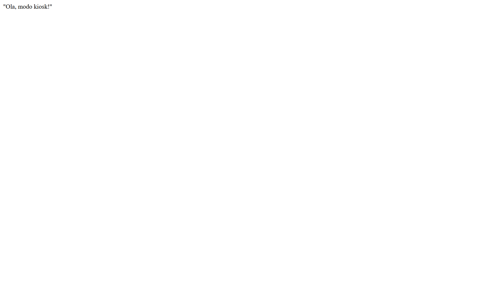

# Diário de Bordo - Sprint 1 (S1)

## Ferramentas Instaladas e Repositório
- VS Code configurado com as extensões Live Server, Prettier e HTML CSS Support.
- Conta no Figma criada.
- Repositório criado com as pastas: `frontend/recepcao/`, `frontend/atendente/` e `prototipos/`.
- Link do repositório: https://github.com/resenderavi/porteiro-digital/edit/main/diario.md
- Obs: O arquivo HTML teste está na pasta frontend/recepcao.

## Desafios e Dúvidas
No momento de testar o modo Kiosk, o terminal do PowerShell não reconheceu o comando padrão. A solução foi adaptar o comando usando `Start-Process chrome -ArgumentList "--kiosk", "--app=..."`.

## Jornadas do Sistema e Alinhamento
Após a leitura da documentação e a reunião de kick-off com toda a equipe (Ravi, Maria Eduarda, Lucas e Pedro), alinhamos as dependências do projeto e listamos as 3 jornadas principais:
1. Visitante chegando à recepção.
2. Atendente recebendo a notificação.
3. Responsável aprovando a visita.

## Comprovação do Kiosk

---

# Revisão das entregas S5, S6 e S7 — telas iguais ao protótipo do Figma (12/11/2026)

Refiz a tela da recepção e o painel do atendente para seguirem os wireframes da S3 e o protótipo do Figma da S4.

## O que mudou

**Tela da recepção (`frontend/recepcao/index.html`, S5)**: os 3 estados do wireframe.
1. Boas-vindas: "Bem-vindo!" + "Toque aqui para iniciar".
2. Formulário em duas colunas: Nome, Motivo, CPF e Responsável (lista vinda da API) + "Avançar". O CPF tem máscara e validação dos dígitos, e os campos com erro ficam em vermelho.
3. "Registro concluído!" com a hora de entrada (calculada pelo frontend) + "Sair". Volta sozinha ao início depois de 15 s.
- Mantidas as regras de kiosk da S5: sem rolagem, cursor oculto (`?cursor=1` mostra o cursor para testar no PC), fonte base 20px, botões com 60px ou mais. Em retrato (800×1280) o formulário vira uma coluna.

**Painel do atendente (`frontend/atendente/index.html`, S6)**
- Fila à esquerda (nome, hora e status com as cores da S6: laranja aguardando, azul em aprovação, verde autorizado, vermelho recusado).
- Detalhe do visitante: Nome, CPF mascarado, Motivo, Responsável, Chegada e Status, com **Aprovar** e **Recusar**. Ao abrir um visitante "aguardando", ele passa para "em aprovação".
- Tabela "Registros do dia": Nome, Hora de entrada e Status.

**Mocks e contrato (S7)**
- `frontend/js/api.js`: as telas chamam só esta camada. Em modo `mock` ela lê os JSON por `fetch()` e guarda o estado no `localStorage`, para o tablet e o painel conversarem entre abas. Para usar a API do Lucas, basta trocar `MODO` e `BASE_URL`.
- `fila.json`, `historico.json` e o novo `responsaveis.json`.
- `api-contrato.md` com os 5 endpoints. **Falta a aprovação do Lucas.**

## Como testar
1. Abrir a pasta no VS Code e iniciar o Live Server.
2. Aba 1: `http://localhost:5500/frontend/recepcao/?cursor=1` (tablet).
3. Aba 2: `http://localhost:5500/frontend/atendente/` (atendente).
4. Cadastrar um visitante na aba 1 (CPF de teste: `529.982.247-25`). Ele aparece na fila da aba 2 sem recarregar; aprovar ou recusar e ver a tabela atualizar.
5. Kiosk no Windows: `Start-Process chrome -ArgumentList "--kiosk", "--app=http://localhost:5500/frontend/recepcao/"`

## Divergências com o Documento de Requisitos v1.0 (para a equipe decidir)
As telas seguem o protótipo, mas o documento de requisitos (03/11/2026) pede algumas coisas diferentes:
- **CPF:** o documento pede só nome, motivo e, opcionalmente, com quem falar (RF10), por causa da coleta mínima da LGPD.
- **Aprovar/Recusar no atendente:** pela RN14 o atendente não autoriza visitantes; quem decide é o responsável pelo celular (RF11).
- **Faltam no protótipo:** foto do visitante (RF16), tela inicial com "Tenho cadastro / Sou visitante", status do pedido na tela (RF25), entrada de cadastrados por credencial (RF01) e chamar atendente (RF31).

Levar esses pontos para a orientadora e para a revisão cruzada da S8.